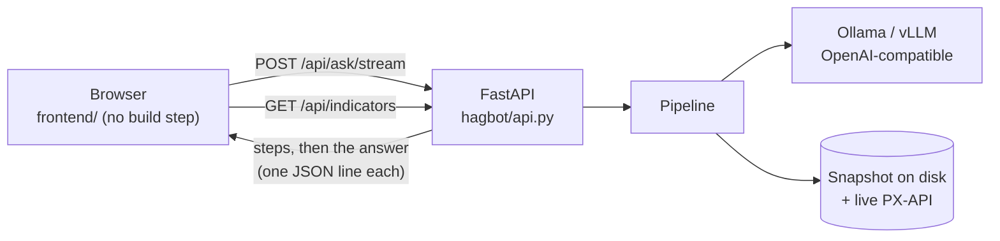

# How RAGstofan answers a question

A language model does three jobs: read the question, pick a table, pick categories. It never does arithmetic and
never gets the last word on a number. Everything that can be checked is done in code.

```mermaid
flowchart TD
    Q(["Question, English or Icelandic<br/><i>Hve mörgum fleiri karlar en konur búa á Íslandi?</i>"])

    subgraph understand["1 · Understand"]
        R{"Ratio to population?<br/>per inhabitant · á hvern íbúa"}:::code
        P["Plan<br/>split into parts, reword in English<br/><i>How many more men than women live in Iceland?</i>"]:::llm
    end

    subgraph find["2 · Find the table (per part)"]
        A{"Word with no single table?<br/>tourists · ferðamenn"}:::code
        S["Keyword search over 1,857 tables<br/>titles EN + IS, dimension names, category labels,<br/>synonyms · searches the English wording AND the original"]:::code
        N["Narrow by rule<br/>drop forecasts / seasonally adjusted unless asked,<br/>keep tables that have the place or month asked for"]:::code
        T["Pick one table from the shortlist"]:::llm
        F["Freshest sibling<br/>same table, newer edition"]:::code
    end

    subgraph read["3 · Read the numbers"]
        C["Choose categories<br/>Sex: Males, Females · Year: 2026"]:::llm
        V["Validate and fix every choice<br/>codes must exist · defaults: total, latest period ·<br/>Iceland = whole country · use the table's own % change ·<br/>trend wording → whole series · share needs a whole"]:::code
        D[("Data<br/>organisers' snapshot of 18 Oct 2026 on disk,<br/>live PX-API for what it lacks")]:::data
        E["Empty latest period?<br/>step back to the last one with numbers"]:::code
    end

    subgraph answer["4 · Answer"]
        K["Calculate<br/>difference · % change · share · ratio · series"]:::code
        M["Merge parts from the same table<br/>into one chart with a line each"]:::code
        G["Chart type from the data's shape<br/>line · bars · slope · donut · heatmap …"]:::code
        W["Write 1–3 sentences in the user's language"]:::llm
        X{"Every number in the text<br/>is in the table?"}:::code
        TPL["Fixed template from the numbers"]:::code
    end

    OUT(["Answer: number, unit, source table, chart,<br/>and every step with its time"])
    ASK(["Ask the user which table they mean"])

    Q --> R
    R -- yes --> RP["Numerator via the planner,<br/>population from MAN00101"]:::code --> A
    R -- no --> P --> A
    A -- yes --> ASK
    A -- no --> S --> N --> T --> F --> C --> V --> D --> E --> K --> M --> G --> W --> X
    X -- yes --> OUT
    X -- no --> TPL --> OUT

    classDef llm fill:#e0b37b,stroke:#8a6a3f,color:#1d1d1f
    classDef code fill:#d3edf5,stroke:#285971,color:#0b3f4d
    classDef data fill:#0b3f4d,stroke:#0b3f4d,color:#ffffff
```

Gold: the language model (qwen2.5:14b through Ollama, or any OpenAI-compatible server). Blue: plain code. Each step
is streamed to the browser the moment it finishes, so the user watches the route being taken.

## Why Icelandic questions are reworded in English

It is not a translation step for its own sake. Three parts of the pipeline work better in English:

1. **The table metadata the bot reads is the English edition.** Category labels are "Males", "Females",
   "Total", "Annual change, %". When the model chooses categories, it matches the question's words to these
   labels, and a 14B model matches *men → Males* far more reliably than *karlar → Males*.
2. **The model reasons better in English.** Qwen2.5-14B handles Icelandic, but its English is much stronger;
   splitting a question and choosing categories are where mistakes cost the most.
3. **Some Icelandic words are easy to mistranslate**, so the planner carries a glossary: *atvinnuleysi* is
   unemployment (not employment), *verðmæti* is a value in ISK (not a price index), *búa* means population.

Nothing is lost: the search runs on the English wording **and** the user's original Icelandic together, and
the Icelandic table titles are indexed. The category step also sees both. The answer is written back in
Icelandic.

Reading the Icelandic edition of the metadata for Icelandic questions is possible, since the snapshot has both
languages. It would make sense with a model that is strong in Icelandic.

## The pieces

| Step | File | Model? |
|---|---|---|
| Plan | `hagbot/steps/plan.py` | yes |
| Ratio to population | `hagbot/steps/ratio.py` | no |
| Search | `hagbot/catalog.py` (BM25 over three fields; optional bge-m3 vectors fused by rank) | no |
| Narrow, ambiguity, pick table | `hagbot/steps/retrieve.py` | pick only |
| Choose and validate categories | `hagbot/steps/select.py` | choose only |
| Data | `hagbot/sources.py` (local snapshot, live PX-API, fixtures) | no |
| Calculate | `hagbot/steps/compute.py` | no |
| Chart | `hagbot/steps/chart.py` | no |
| Write and check | `hagbot/steps/compose.py` | write only |
| Orchestration, merging, streaming | `hagbot/pipeline.py`, `hagbot/api.py` | no |
| Dashboard numbers | `hagbot/indicators.py` (read straight from the data, no model) | no |

