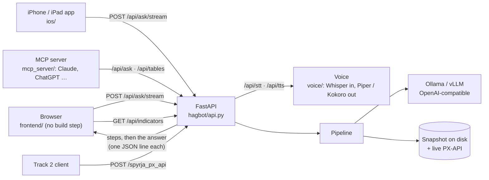

# How RAGstofan answers a question

A language model reads the question, picks a table, picks categories and writes the answer. It never does
arithmetic and never gets the last word on a number. Everything that can be checked is done in code.

```mermaid
flowchart TD
    subgraph key["Key"]
        direction LR
        KL[["LLM call"]]:::llm
        KC["Code"]:::code
        KQ{"Check in code"}:::code
        KD[("Data")]:::data
    end

    Q(["Question, English or Icelandic<br/><i>Hve mörgum fleiri karlar en konur búa á Íslandi?</i>"])

    subgraph understand["1 · Understand"]
        FU{"Follow-up?<br/>what about last year · hvað með árið áður"}:::code
        RW[["LLM ① Rewrite as a question that stands alone,<br/>from the previous question and answer"]]:::llm
        TB{"Table already chosen?<br/>the user clicked a clarification button"}:::code
        R{"Ratio to population?<br/>per inhabitant · á hvern íbúa"}:::code
        SR{"Rate published in a table?<br/>GDP per capita · Vehicles per 1,000 inhabitants<br/>(not when the population date is named)"}:::code
        RP["Split in code: numerator, and the population<br/>of the place asked on 1 January (MAN00101 for Iceland)"]:::code
        P[["LLM ② Plan<br/>split into 1–3 parts, reword in English, English search words,<br/>and per part the facts: places · period and its kind · breakdown wanted"]]:::llm
        VF["Check the facts in code<br/>a place or period not in the question's own words is dropped ·<br/>one measure at two periods becomes one part"]:::code
    end

    subgraph find["2 · Find the table (each part in parallel)"]
        A{"Word with no single table?<br/>tourists · ferðamenn"}:::code
        DICT["Keyword dictionary<br/>data/keywords.json: verðbólga → consumer price index → VIS01000<br/>adds the official term to the search"]:::code
        subgraph search["Search 1,857 tables, in parallel · English wording + the original"]
            S1["BM25 keywords · top 120<br/>titles EN + IS, dimension names, option labels,<br/>prefix match, synonyms, tables matching every word first"]:::code
            S2["e5 vectors · top 120<br/>meaning of each table's description:<br/>titles, dimensions IS + EN, period, options"]:::code
            S3["Example questions · off by default (USE_EXAMPLES)<br/>e5 over questions whose table is known"]:::code
        end
        RK["Rank: dictionary tables first, then the searches<br/>fused by rank, 1 / (60 + rank) from each, × recency"]:::code
        N["Narrow by rule<br/>drop trend / seasonal / forecast / census and old index bases unless asked,<br/>keep tables with the place, month or year asked for,<br/>and with the breakdown named (by age · eftir sveitarfélögum)"]:::code
        DD{"One subject, its headline table on top,<br/>nothing asked beyond it?"}:::code
        T[["LLM ③ Last resort: must pick one table<br/>from the hitlist"]]:::llm
        CK[["LLM ③ Check the hitlist, 8 tables at a time, ≤ 2 rounds<br/>pick one, or say none fits · votes"]]:::llm
        BR[["LLM ③ Browse: choose ≤ 2 subject areas"]]:::llm
        CK2[["LLM ③ Check tables in those areas,<br/>8 at a time, ≤ 4 rounds · votes"]]:::llm
        F["Freshest sibling<br/>same table, newer edition"]:::code
    end

    subgraph read["3 · Read the numbers (each part)"]
        C[["LLM ④ Choose categories<br/>Sex: Males, Females · Year: 2026 · votes"]]:::llm
        V["Validate and fix every choice, using the plan's facts<br/>codes must exist · defaults: total, latest period · period from the question ·<br/>only the places named · categories not named → the total, the rest as chips ·<br/>Iceland = whole country · current index base · the table's own % change ·<br/>trend wording → whole series · highest / lowest · share needs a whole"]:::code
        SW{"Month or quarter asked is after<br/>the table's last period?"}:::code
        SB["Switch to the neighbouring table that has it<br/>(LAU04000 → LAU04001), choose again"]:::code
        D[("Data<br/>organisers' snapshot of 18 Oct 2026 on disk,<br/>live PX-API for what it lacks")]:::data
        E["Empty latest period?<br/>step back to the last one with numbers"]:::code
        K["Calculate<br/>difference · % change · share · sum · series · max / min · rank"]:::code
        NT["Data ends in an earlier year?<br/>note a table on the subject with newer figures"]:::code
    end

    subgraph answer["4 · Answer (all parts together)"]
        M["Merge parts from the same table<br/>into one chart with a line each"]:::code
        RD["Two parts into one number, in code<br/>per inhabitant: divide by the population ·<br/>share across two tables · change between two parts"]:::code
        G["Chart type from the data's shape<br/>line · bars · slope · donut · heatmap …<br/>series from different tables: one chart, each set to 100"]:::code
        W[["LLM ⑤ Write 1–3 sentences in the user's language"]]:::llm
        X{"Every number in the text<br/>is in the table?"}:::code
        TPL["Fixed template from the numbers"]:::code
    end

    OUT(["Answer: number, unit, source table, chart, drill-down chips,<br/>and every step with its time"])
    SG[["LLM ⑥ Follow-up suggestions, after the answer is shown<br/>compare · related · dig deeper · bigger picture"]]:::llm
    ASK(["Ask the user which table they mean"])

    Q --> FU
    FU -- yes --> RW --> TB
    FU -- no --> TB
    TB -- yes --> C
    TB -- no --> R
    R -- yes --> SR
    SR -- "yes: read it, no division" --> C
    SR -- no --> RP --> P
    R -- no --> P
    P --> VF --> A
    A -- yes --> ASK
    A -- no --> DICT --> search --> RK --> N --> DD
    DD -- "yes: the dictionary decides" --> F
    DD -- "no: top 16" --> CK
    CK -- "a table, snapped to the subject's headline<br/>table unless a breakdown was asked" --> F
    CK -- none fits --> BR --> CK2
    CK2 -- a table --> F
    CK2 -- "none fits" --> T --> F
    F --> C --> V --> SW
    SW -- yes --> SB --> D
    SW -- no --> D
    D --> E --> K --> NT --> M --> RD --> G --> W --> X
    X -- yes --> OUT
    X -- no --> TPL --> OUT
    OUT -.-> SG

    classDef llm fill:#e0b37b,stroke:#8a6a3f,stroke-width:2px,color:#1d1d1f
    classDef code fill:#d3edf5,stroke:#285971,color:#0b3f4d
    classDef data fill:#0b3f4d,stroke:#0b3f4d,color:#ffffff
```

Gold, double-edged boxes are LLM calls (through Ollama or any OpenAI-compatible server; `.env.example` sets
qwen2.5:14b, and the latest eval runs use qwen3.6:35b-a3b); the circled
number is the call's kind, counted in the table below. Blue is plain code. "votes": with `VOTES` > 1 or `VOTE_MODELS`
set, that call is asked several times in parallel and the majority wins (off by default). Each step is streamed to the
browser the moment it finishes.

### LLM calls per question

| # | Call | When | Calls |
|---|---|---|---|
| ① | Rewrite a follow-up | the wording leans on the previous turn | 0–1 |
| ② | Plan, with each part's places, period and breakdown | always, unless the user clicked a table or a published per-inhabitant rate answers it | 0–1 |
| ③ | Find the table | per part: none when the table is fixed (clicked, or population for a ratio) or the dictionary decides alone; otherwise check 1–2 rounds; if none fits, browse 1 + check 1–4 rounds; if still none, a forced pick 1 | 0–8 per part |
| ④ | Choose categories | per part; again if it switches to a neighbouring table | 1–2 per part |
| ⑤ | Write the answer | when at least one part has numbers | 0–1 |
| ⑥ | Follow-up suggestions | after the answer is on screen (`/api/suggest`), so it adds no answer time | 0–1 |

A one-part question makes 3–4 calls before the answer (plan, find 0–1, categories, write), and one more for suggestions. Voting multiplies the
calls marked "votes" by the number of votes; they run in parallel, so it costs compute more than time.

## Why Icelandic questions are reworded in English

It is not a translation step for its own sake. Three parts of the pipeline work better in English:

1. **The table metadata the bot reads is the English edition.** Category labels are "Males", "Females",
   "Total", "Annual change, %". When the model chooses categories, it matches the question's words to these
   labels, and a 14B model matches *men → Males* far more reliably than *karlar → Males*.
2. **The model reasons better in English.** Qwen2.5-14B handles Icelandic, but its English is much stronger;
   splitting a question and choosing categories are where mistakes cost the most.
3. **Some Icelandic words are easy to mistranslate**, so the planner carries a glossary: *atvinnuleysi* is
   unemployment (not employment), *verðmæti* is a value in ISK (not a price index), *búa* means population.

Nothing is lost: the search runs on the English wording **and** the user's original Icelandic together, and
the Icelandic table titles are indexed. The category step also sees both. The answer is written back in
Icelandic.

Reading the Icelandic edition of the metadata for Icelandic questions is possible, since the snapshot has both
languages. It would make sense with a model that is strong in Icelandic.

## The pieces

| Step | File | Model? |
|---|---|---|
| Plan, and the check of its facts | `hagbot/steps/plan.py` | plan only |
| Ratio to population | `hagbot/steps/ratio.py` | no |
| Follow-up rewrite | `hagbot/steps/followup.py` | rewrite only |
| Search | `hagbot/catalog.py` (BM25 over three fields) and `hagbot/e5.py` (e5 vectors, on by default; optional bge-m3 in `hagbot/vectors.py`), run in parallel and fused by rank | no |
| Table finder (the only path) | `hagbot/steps/tiered.py`, keyword dictionary `data/keywords.json` | check and browse |
| Narrow, ambiguous words, last-resort pick | `hagbot/steps/retrieve.py` | pick only |
| Example questions (off) | `hagbot/examples.py` | no |
| Majority voting (`VOTES`, `VOTE_MODELS`) | `hagbot/vote.py` | repeats a call |
| Choose and validate categories | `hagbot/steps/select.py`, category codes `hagbot/hierarchy.py` | choose only |
| Data | `hagbot/sources.py` (local snapshot, live PX-API, fixtures) | no |
| Calculate | `hagbot/steps/compute.py` | no |
| Chart | `hagbot/steps/chart.py` | no |
| Write and check | `hagbot/steps/compose.py` | write only |
| Follow-up suggestions | `hagbot/steps/suggest.py` | yes |
| Orchestration, merging, streaming | `hagbot/pipeline.py`, `hagbot/api.py` | no |
| Dashboard numbers | `hagbot/indicators.py` (read straight from the data, no model) | no |

