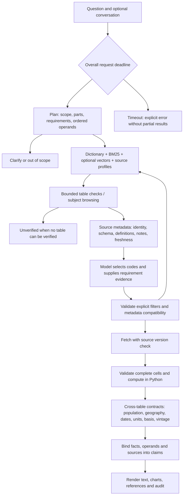

# How RAGstofan answers a question

The model interprets questions and proposes source tables and selections. Source checks, arithmetic, completeness,
cross-table compatibility and final claim rendering run in code. The keyword dictionary and tiered finder remain
shared with the team's search harness.

Retries exclude rejected IDs and preserve the original question specification. Rankings are cached per part.
No forced table pick remains. The dictionary fast path saves the picker-model call but still passes through source
validation. A failed part prevents the whole question from being labeled answered. Published rates retain direct
routing and validation; coded population ratios keep explicit denominator dates and places.

## Source metadata and discovery

The local release supplies PX headers with definitions and scoped notes. `scripts.build_source_profiles` provisions
these for source-text discovery. For live sources the offline warmer obtains a one-cell PX export, discards the
cell and stores the definitions. Question handling never fetches numeric cells to enrich a rejected candidate.
Generated catalog text and dictionary associations remain retrieval hints, not source evidence.

`FRESHNESS_POLICY=snapshot` preserves the organizer release and discloses its date. Live mode uses live metadata
and cells together. Metadata and numeric caches have separate TTLs; expired refresh failures do not serve stale
results. Observed source version changes stop the answer. See [implementation details](correctness-implementation.md).

## LLM calls

| Stage | Calls |
| --- | --- |
| Rewrite a follow-up | 0–1 |
| Plan requirements and scope | Normally 1; malformed JSON can retry |
| Table selection | 0 on dictionary/forced routes; otherwise bounded checks and browsing |
| Select categories and cite compatibility evidence | 1 per candidate; optional voting can repeat |
| Cross-table checks, calculations, final claim rendering | 0 |
| Suggestions after answering | Separate from the answer |

A simple dictionary lookup normally needs two calls: planning and category selection. A table-picker call usually
brings that to three. Parsing retries, multiple parts, candidate retries and optional votes add calls. The whole
answer defaults to a 30-second response budget. This is not a measured latency guarantee.

## Response contract

`Answer.status` distinguishes answered, clarify, out_of_scope, unavailable, unverified and error. Answered responses
carry complete parts, source references, source-bound claims and verification records. Other outcomes clear parts,
sources and claims. NDJSON streams step progress and then one terminal answer. The MCP adapter preserves the
outcome, contexts and claims, and explicitly reports omitted raw rows.

Final text is rendered from bound values/labels/units/periods and calculation operands. It is no longer accepted
just because its numbers appear somewhere in the facts. Series summaries use the complete series' endpoints and
computed peak; full data remain available in structured rows and charts.

## Main modules

| Purpose | Module |
| --- | --- |
| Dictionary and tiered finder | `hagbot/steps/tiered.py`, `data/keywords.json` |
| BM25, source-profile search, optional vector fusion | `hagbot/catalog.py` |
| Question requirements and source evidence | `hagbot/specification.py`, `hagbot/semantics.py` |
| Metadata adapters, cache TTLs, snapshot/live data | `hagbot/sources.py`, `hagbot/profiles.py` |
| Filter preservation | `hagbot/steps/select.py`, `hagbot/steps/constraints.py` |
| Calculation and cross-table contracts | `hagbot/steps/compute.py`, `hagbot/steps/ratio.py`, `hagbot/contexts.py` |
| Claim binding and text rendering | `hagbot/claims.py`, `hagbot/steps/compose.py` |
| Orchestration and deadline | `hagbot/pipeline.py` |
| API/stream and MCP | `hagbot/api.py`, `mcp_server/adapter.py` |
| Repeated outcome/accuracy/latency evaluation | `eval/integrity_eval.py` |

The remaining phase is serving-model evaluation and calibration. Offline regressions establish control-flow and
integrity behavior; unknown methodological definitions or geography relationships remain unverified.
